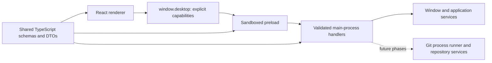

# Architecture and implementation decisions

Status: foundation, the local F01 repository slice, the first F02 manager scan slice, the initial
F03 tab slice, the initial F04 history/selection slice, the initial F07 revision-inspection slice, the
initial F08 working-changes slice, the initial F09 text-diff slice, the initial F10 staging slice, the
initial F11 commit slice, the initial F12 branch/tag slice, the initial F13 remote and network slice
with its F14 operation registry, background-fetch scheduler, and activity views, the F01–F13 stabilization, minimal saved-change/pull recovery, the initial F15 stash/patch slice, bounded F17 conflict-helper, F19 history-operation, F20 reflog, and F21 file-history/Blame slices, a branch PR browser handoff, the initial F34 workspace-chrome slice, the bounded F22 worktree lifecycle slice, the bounded F23 submodule lifecycle slice, and the bounded F24 local LFS slice implemented. The bounded F25 native Git-flow slice is implemented and verified through its dated handoff.
The bounded F26 manual Bisect slice reads durable per-worktree Git state through named validated
capabilities and serializes start/mark/skip/reset through the common-directory operation queue. Its
snapshot covers HEAD, bisect files/refs, status and pending sequencers. First-bad and ambiguous skipped
candidates are outcomes, and app restart reconstructs the banner without duplicating Git state.
See the [F26 handoff](reviews/f26-bisect.md) for verified behavior and limits.
F28 adds named signing-settings reads, a repository-local signing-key write with snapshot validation
inside the common-directory queue, and exact-object GPG verification. Commit/tag requests have an
optional Git-default/GPG/Unsigned choice. Signing stays with Git and its native GPG agent; signer
output is suppressed in signed commit and tag results, and verification exposes only validated status
and public fingerprint. Inspector windows may verify but cannot change signing configuration.
See the [F28 handoff](reviews/f28-signing.md) for the bounded OpenPGP workflow and platform limits.
F22 topology reads and create/open/remove/prune operations use backend-issued worktree IDs, common-directory
serialization, linked-tab sessions, and explicit current/main/occupied/dirty/locked/stale guards. F23
submodule reads and actions use backend-issued submodule IDs, parent/index/child gitlink comparison,
common-directory serialization, dirty-path guards, and backend-resolved child sessions. F24 LFS reads,
local initialization, and historical Save As use backend pointer parsing, local object-cache lookup,
SHA-256 verification, operation progress, and native destination selection; no remote transfer or lock
capability is exposed. The remaining P09 variants are still design decisions, not existing code.

## Catalogue-driven corrections (F01–F24 bounded slices verified, 2026-09-20)

The [Windows 2.22.0.0 catalogue alignment](research/fork-catalogue-alignment.md) changes the observable
target without changing the Electron/TypeScript boundaries. C01–C06 in the
[implementation plan](implementation-plan.md#catalogue-correction-sequence) own the work below. The
[F01–F16 correction record](reviews/f01-f16-catalogue-corrections.md) identifies implemented behavior,
tests and remaining limits. The [F19 history-operation handoff](reviews/f19-history-operations.md) records
the bounded cherry-pick/revert/reset slice. Additive repository navigation, annotated empty-message tags, scoped search,
diff controls/discard, merge modes, clone/authentication and lifecycle corrections are now implemented.
The later initial-slice descriptions are historical where superseded here. Commit details now support a
separate read-only native window; directory/selected-code history and full conflict-family variants remain
future work. The bounded F17 conflict helper, F18 interactive-rebase workflow, F20 reflog mode, and F21
file-history/Blame inspectors are recorded in their dated handoffs.

- **Navigation and command state:** one repository-session/order model feeds horizontal tabs and the
  optional workspace repository list simultaneously. Keep repository-list visibility separate from
  Commit List Layout. Migrate existing orientation preferences without losing sessions. A shared
  renderer command model supplies context, availability and shortcuts to menus, toolbar and Quick Launch;
  backend preconditions remain authoritative for mutation. Resolve current view/tab/zoom shortcut conflicts.
- **View state:** distinguish repository, revision/path, index/worktree side, diff layout and window owner.
  Store line anchors/focus separately from byte snapshots and persisted settings. A popup can share file
  selection with its owner while keeping an independent diff layout. Normal restart, in-session switching
  and interrupted Git operations need separate retention rules; see the table below.
- **Inspection windows:** the diff popup remains an owned modal inspector inside the renderer. Commit
  details use the fixed `openCommitDetails`/`getCommitDetailsContext` capabilities and a separate sandboxed
  window, initialized with validated repository/commit/tab/path/theme DTOs. Main attaches a non-persisted
  repository session without scheduling fetch and restricts the child to committed reads and local
  copy/window controls. Generic repository mutations, working-tree reads, more window creation and app
  quit are denied even though the shared preload contains those method names. The selected commit stays
  independent of main-window selection, with parent navigation inside the inspector. At most eight
  inspectors per owner can be opening/open. Parent-window close releases children, sessions, reads and
  listeners; closing the repository tab alone leaves its inspector usable. No renderer-selected URL,
  filesystem access or generic window creation is exposed. File-history and Blame windows use the same
  fixed-document and owned-session policy, allow only committed reads plus a named commit-details handoff,
  and cap eight inspectors per owner. Directory/selected-code history remains future work.
- **Diff interaction geometry:** plain `@@` lines participate in horizontal text scrolling. Changed-row
  groups own an out-of-flow highlight layer; its outline and buttons stay within the viewport on hover
  or keyboard focus. Unified hunks share a document width so gutters and actions remain aligned even
  when another hunk contains a longer line. Line anchors use viewport geometry across nested groups.
- **Details and toolbar controls:** the history/detail splitter is bounded by available container height
  and keeps the last usable size while hidden; visible buttons and Ctrl+Shift+D hide/restore it. The
  Branch/Stash primary segments open their existing dialogs; separately focusable chevrons open menus.
- **Diff data:** extend named contracts/preload/handlers/services together for context/full-file/explicit
  large-diff access. Keep bounded output, cancellation, generation guards and safe asset delivery; a
  Load Diff control cannot bypass resource limits. Reuse presentation in inspectors without conflating
  their view state with the working-tree mutation snapshot.
- **Semantic corrections:** tag kind cannot be inferred from a nonempty message; the captured route
  creates an annotated object even with an empty annotation. Stash Stage new files is not interchangeable
  with include-untracked: represent the intended policy explicitly and verify stash parent/index shape.
  Preserve existing recovery, identity validation and operation queues while revising contracts/tests.
- **Merge/conflict/rebase:** add an explicit merge mode, not raw flags. Backend data includes base/ours/
  theirs, index stages and the sequencer; F16's four merge modes and paused squash recovery, F17's bounded
  text helper, and F18's reviewed interactive plan are implemented within their handoffs. Resolve
  writes/stages; Commit/Continue advances history. Interactive Edit pause, amend and replay are distinct
  operation states. Model squash pending state independently of MERGE_HEAD presence.
- **Activity:** keep process/job outcome separate from repository sequencer state. Cancel-requested is
  not proof of termination or remote rollback; a finished process can leave a conflict requiring recovery.
  Preserve structured errors and do not reproduce misleading captured Activity success labels.

| State                                             | Captured Windows scope                                                          | Planned project policy                                                           |
| ------------------------------------------------- | ------------------------------------------------------------------------------- | -------------------------------------------------------------------------------- |
| Tabs/order/active repository/window/sidebar width | Restored in normal restart, P2-015                                              | Restore with schema migration and off-screen recovery.                           |
| Selected commit/detail tab                        | Resets to HEAD/Commit in sampled restart                                        | Match on normal restart; preserve drafts and operation recovery independently.   |
| Horizontal pane divider                           | Sampled position resets in P2-015                                               | Keep useful existing persistence as a documented deviation.                      |
| Diff file/line anchor/layout                      | Retained across sampled in-session file/view/repository/layout switches, P0-028 | Retain within that session/target; define stale-content invalidation explicitly. |
| Post-hunk selection/focus                         | Viewport retained, highlight cleared, file row focused, P0-032                  | Reconcile after successful mutation; preserve recoverable state on failure.      |
| Drafts and unfinished operations                  | Full persistence not established by the clean restart captures                  | Preserve drafts and durable recovery as independent product requirements.        |
| Theme and other preferences                       | Light restored in a sampled restart; defaults/nondefault retention incomplete   | Preserve explicit user choices; do not describe them as proven Fork defaults.    |

UIA names, HWNDs, physical screenshot coordinates, Windows paths and capture scripts are evidence, not
application abstractions. Exact fonts/colors, alternate commit-layout behavior, 125% DPI and inaccessible
focus/clipping states do not justify guesses presented as parity. Independently authored Linux behavior
and tests remain required. Public-only integrations and Git-flow retain their separate phase scope.

New named capabilities cover clone, connection tests, global fetch preference, tab reorder/list visibility,
discard preview and diff cancellation. Existing history/diff requests gain validated bounded options.
The repository-activated event carries a validated summary for CLI/second-instance opening and uses
the same exact subscription cleanup as operation events. Workspace persistence migrates version 1 to 2
without losing open paths/order; the legacy orientation channel maps to repository-list visibility.
Window geometry uses a separate bounded, versioned atomic file and validates placement against usable
display workareas, with a fallback for Ozone's 1×1 virtual display.

Authentication remains between Git and installed helpers/agents. Silent runner calls suppress askpass
and standard credential-manager dialogs; explicit network work may prompt through those tools. Secrets
never enter DTOs or renderer state. The broad trust policy for arbitrary configured programs is still
unresolved. Long reads and mutations preserve owner/generation guards, bounded output and job cancellation;
cancellation requested is distinct from terminal status. No automatic rollback or retry is inferred.

## Process boundaries

F32 adds `desktop.customCommands` definition CRUD, native import/export/file selection, preview and
token-only run capabilities. Profile definitions are main-owned, versioned, bounded and atomically
saved; imported definitions are disabled. Preview resolves context and inputs in the backend and binds
a one-use window-owned token to the saved revision and repository/ref state. Execution revalidates
inside the common-directory mutation queue and uses the existing operation registry/events/cancellation.
Start Process uses direct argv, Bash uses environment values rather than template insertion into code,
and URL actions are limited to reviewed HTTP(S) destinations. Processes have bounded output and lifetime;
inspector windows are denied every custom capability. No repository-provided definition auto-loads or
auto-executes. This is an explicitly enabled user-program feature, not a generic renderer execution API
or a sandbox for untrusted programs. See [F32](reviews/f32-custom-commands.md) for the independent
format, variable conventions, process supervision and remaining parity limits.

F31 Quick Launch is a renderer-only projection of menu actions plus typed parameter choosers.
It reuses existing reference context, committed-tree reads, merge/rebase/checkout operations,
repository opening and owned file-history inspectors. No new IPC, generic execution capability,
subscriptions or persisted state are introduced. Async lookups discard results on dismissal and
stop scheduling bounded tree reads; repository/ref-snapshot and busy-state changes close a parameter
chooser while the root command list updates in place.
The [F31 handoff](reviews/f31-quick-launch.md) records enumeration bounds and independent fuzzy ranking.

The renderer owns presentation and transient view state. The preload adapts a narrow API to Electron
IPC. Main owns privileges, resource lifetime, and future Git orchestration. Shared code contains
serializable data and schemas; it cannot import Electron, Node, or frontend state libraries.
DTOs cross IPC, not class instances with methods, Redux actions, errors, or native event objects.

The initial UI uses React state. The starter's Redux store contained only a context-menu demo. The
initial F03 slice keeps tab, active-repository, and status-refresh state in the repository hook while
the backend remains authoritative for canonical sessions, persisted tab order, and preferences. A
larger shared state layer can be introduced with history and changes queries when their selection and
invalidation lifecycles are understood.

## Build and dependency decisions

One `electron.vite.config.ts` builds main, preload, and renderer. It replaces the three Webpack
configurations and custom Electron launcher. See the [electron-vite guide](https://electron-vite.org/guide/).

Main and preload are explicit CommonJS `.cjs` bundles; the renderer uses browser ESM. The package uses
ESM for tooling. Preload dependencies are fully bundled so the sandbox only needs Electron's supported
runtime APIs. This follows [electron-vite's dependency guidance](https://electron-vite.org/guide/dependency-handling).
Do not introduce a dynamic preload chunk or a runtime require of an application dependency.

Compatibility was checked against npm metadata on 2026-09-16: electron-vite 5 accepts Vite 7, so this
project uses Vite 7 rather than upgrading independently to Vite 8. The React plugin is on its compatible
5.x line. TypeScript is on 6.0 because the selected typescript-eslint version declares support below
6.1. Electron is on 44.x, React on 19.x, and the supported development runtime is Node 24 LTS.
The exact reproducible versions live in `package-lock.json`; recheck peers before future upgrades.

Three type checks protect distinct environments: shared code has no Node/browser globals; renderer
code has browser types; backend/tooling has Node and Electron types. ESLint additionally blocks Node,
Electron, and backend imports from the shared and renderer directories.

## IPC contract

F27 extends `getDiff` with optional `includeImages` and bounded raster sides. The existing preload
and main handler validate the shared request/result schemas and retain owner/frame and inspector
authorization. Main resolves patch blob IDs and bounded regular-file reads; it returns only static
PNG/JPEG bytes with checked dimensions, after metadata removal. The renderer decodes raster Blobs
inside its sandbox, closes replaced/late bitmaps and draws Side-by-Side/Swipe/Onion Skin/Pixel on
bounded canvases. Repository URLs and SVG documents never enter the rendering path; no CSP changes
or general asset protocol are required. Limits, alpha/pixel policy, and unsupported formats are
specified in the [F27 handoff](reviews/f27-image-diffs.md). The diff hook compares target identity and
image payloads when reusing results, preventing two empty-text binary revisions from sharing a view.

| Concern                   | Location                                      | Rule                                                               |
| ------------------------- | --------------------------------------------- | ------------------------------------------------------------------ |
| Request names and schemas | `src/common/ipc/contracts.ts`                 | Stable names such as `app:get-info`; separate input/output schemas |
| Result envelope           | `src/common/ipc/result.ts`                    | `{ ok, value }` or `{ ok, error: { code, message } }`              |
| Renderer capabilities     | `src/common/ipc/api.ts`                       | Named methods; no arbitrary channel or process access              |
| Preload implementation    | `src/backend/preload/create-desktop-api.ts`   | Validate responses/events, strip native events, bound wait time    |
| Main execution boundary   | `src/backend/electron/ipc/execute-request.ts` | Authorize first, validate input, run service, validate output      |
| Registration and routing  | `src/backend/electron/ipc/register.ts`        | Register once; route to the exact owning window                    |

The actual API is `desktop.app.getInfo()`, `desktop.window.getState()`,
`desktop.window.command({ action })`, and `desktop.window.onStateChanged(listener)`. The F01 slice adds
named `desktop.repository` methods for Git diagnostics, directory selection, open/init, recent/open
session queries, close, and recent-entry removal. The first F02 slice adds manager listing, source-root
add/remove, and explicit rescan methods. The initial F03 slice adds validated tab-preference reads and
writes plus active-tab selection; open-session DTOs include a bounded Git-derived working-tree state.
The initial F04 slice adds a bounded `desktop.repository.getHistory()` query for validated, paged
commit/reference DTOs. The initial F07 slice adds named, bounded `getCommitChanges()`, `getRevisionTree()`,
and `getRevisionBlob()` capabilities for committed path metadata, lazy tree directories, and explicit
text/binary/too-large blob states. The initial F08 slice adds named, bounded `getWorkingChanges()` for
porcelain-v2 staged, unstaged, untracked, and ignored working-tree entries. The initial F09 slice adds a
`getDiff()` capability for validated working or committed targets, bounded
patch text, whitespace comparison modes, and explicit binary/too-large/unavailable states. The renderer
owns unified/split presentation, inline edit highlighting, search, and visible whitespace markers. The
initial F10 slice adds `applyWorkingChange()` for explicit file, hunk, and line stage/unstage actions plus
hunk/line discard; working diff responses carry a backend-issued snapshot token, and the main process
revalidates it before applying a backend-built patch. The renderer owns line selection but never sends
Git patch text or arguments. One request names several files for a whole-file action, so staging a
selection is one round trip and one Git invocation per batch; a hunk or line action still names exactly
one file and must carry its diff snapshot. The initial F11 slice adds `getCommitContext()` and `commit()`: the context
read returns the identity Git would use, the amend target with its published state, a configured template,
pending merge state, recent messages, present commit hooks, and a compare-and-swap token over HEAD, that
pending state, and the staged entries. `commit()` takes only a subject, body, amend flag, token, and an
explicit skip-hooks flag; the message crosses IPC as text and never as Git arguments. `getAmendChanges()`
and the `amend` diff target report what an amended commit would contain, by comparing the index with
HEAD's parent (the empty tree for a root commit). Amend mode is a read: it never moves a commit's changes
into the index, so unticking it cannot lose staged work. Expected commit
failures (a hook, a missing identity, an empty message, nothing staged, unmerged files) produce a
structured terminal `failed` result with bounded inert output rather than an exception.
The initial F12 slice adds `getReferenceContext()` and `applyReferenceAction()`. The context read returns
the local branches with their upstream, stale-upstream flag, linked-worktree checkout, and merged state,
the tags with their peeled commit and annotated flag, the remote and remote-tracking names, the
working-tree and pending-sequencer state, and a compare-and-swap token over HEAD, the local branches, and
the tags. Remote-tracking refs stay outside that token so a background fetch cannot invalidate an open
dialog. `applyReferenceAction()` carries one named action and that token; the renderer never sends Git
arguments, a revision expression, or a force flag it was not offered. A start point is a validated commit
ID checked by Git, or the full name of a reference the context reported. Expected refusals — a name
in use, an unmerged branch, a branch checked out in another worktree, the current branch, local changes a
checkout would overwrite, a running sequencer, a missing tagger identity — return a structured `blocked`
result with the obstacle, the paths Git named, and whether an explicit force would succeed.
The bounded F22 slice adds `getWorktrees()` and `startWorktreeOperation()`. Worktree reads return
backend-issued IDs, branch/head/current/main/lock/prune/status state, and a topology snapshot. Create,
remove, and prune actions are named domain requests; the backend resolves branch sources and worktree
paths, serializes mutations by common Git directory, and returns structured dirty/locked/current/
occupied/stale outcomes through the existing operation registry. The renderer can open a returned path
only through the normal repository session or a validated worktree location; it never sends Git arguments.
The bounded F23 slice adds `getSubmodules()`, `startSubmoduleOperation()`, and `openSubmodule()`. Reads
combine `.gitmodules`, recursive submodule status, parent commit/index gitlinks, and child HEAD/status
into bounded revision/state DTOs. Add/init/update/sync/remove are named actions with a snapshot guard,
common-directory serialization, explicit recursive/local-transport choices, exact dirty-child removal
paths, and operation results that include a fresh context. Child opening resolves the submodule ID in the
backend and uses the normal repository session with an independent display label; no renderer path or Git
argument is treated as authority. Nested mutation, missing-object recovery, interrupted updates, and
submodule conflict continuation remain outside the verified slice.
The bounded F24 slice adds `getLfsFile()`, operation-backed local initialization, and native historical
Save As. Pointer parsing, Git attribute checks, local object-cache lookup, worktree pointer/materialized
state, and SHA-256 verification remain backend-owned; the renderer receives metadata and progress only.
Remote/authenticated transfer, push, locks, track/untrack editing, and remote missing-object recovery
remain outside the verified slice.
The bounded F25 slice adds `getGitFlow()` and `startGitFlowOperation()`. The backend reads conventional
`gitflow.*` repository configuration, exposes explicit initialize/start/finish capability checks, and
uses named ordinary-Git actions for feature, release, and hotfix branches. Finish keeps annotated release
tags, optional develop back-merges, no-fast-forward choice, and branch-retention choice backend-owned;
the renderer receives a fresh context and operation result rather than Git arguments. No external
git-flow executable, remote publishing, automatic stash, or conflict rollback is exposed.
The initial F13 slice adds `listRemotes()`, `applyRemoteAction()`, `startNetworkOperation()`,
`listOperations()`, `cancelOperation()`, and `onOperationChanged()`. A network request is accepted and
answered with a running operation record rather than its result, because a fetch or a push outlives the
preload's 15-second deadline; progress, output, and completion arrive as `repository:operation-changed`
events routed to the window that started the work, and `listOperations()` still answers after every
listener has gone. Operations carry a user/background source. A backend scheduler enables all configured
remotes in open tabs by default, runs every twenty minutes, persists per-remote opt-outs, rotates several
remotes through one repository slot, and uses the repository-global acceptance guard to avoid duplicate
work across windows. The renderer names a remote, branches, and options; it never sends a refspec, a
transport flag, or a force flag it was not offered, and `--force-with-lease` reaches Git only from an
explicit confirmation. The
F34 workspace-chrome slice
extends `desktop.window.command()` with full
screen, zoom, quit, and development-only reload/developer-tools actions (rejected in packaged builds),
adds `fullScreen` to window state, and adds three narrow capabilities: `desktop.edit.command()` for
undo/redo/cut/copy/paste/select-all on the requesting window's focused element,
`desktop.clipboard.writeText()` for bounded text, and `desktop.repository.openInFileManager()`, which
accepts only an open-session, recent, manager-repository, or source-directory ID. The main process
resolves that ID to a path it issued to the same window, requires an existing directory, and opens it
with the desktop's default file manager. Renderer clipboard and permission requests remain denied.

The 2026-09-19 stabilization keeps channel names stable but changes `commit()` and
`applyReferenceAction()` to return an accepted `RepositoryOperation`. Their structured terminal results
are carried by the operation's `result` union. The renderer reconciles events and `listOperations()`
using monotonically increasing revisions; a late accepted reply cannot replace a completed event.
Reference dialogs retain the snapshot the user reviewed, and completions check repository ownership and
generation before changing visible state. All conflicting local/network writes share the common-directory
queue. A Pull validates its destination tip and reviewed context inside that queue; a Pull to an inactive
branch explicitly checks it out first, while Fast-Forward updates it without switching the worktree.

`previewLocalChanges()`, `getRecovery()`, and `recover()` provide bounded change previews and recovery
operations. Stash/reapply and checkout Discard validate the preview, create a named Git stash, pin it
under `refs/git-workbench/recovery/`, and persist a versioned atomic journal in the worktree's Git directory.
Applying with `--index` restores the staged/unstaged distinction. Failed or interrupted work leaves the
copy pending. Recovery actions compare a snapshot of saved entries and Git sequencer anchors before
applying, finishing, or continuing/aborting. Dismissing an entry does not drop Git stash entries.
The F15 stash surface adds `listStashes()`, `getStashDetails()`, and `startStashOperation()`. Stash
selectors never cross IPC: the renderer supplies a full commit ID it received from the list, and the
backend re-reads the reflog list inside the common-directory queue before mapping it to the current
`stash@{n}` selector. Save validates a working-change snapshot and selected paths, supports whole-file
partial stashes and explicit untracked inclusion, and uses Git's stash commit to preserve the index.
Apply and pop use `--index`; pop drops only after apply succeeds, so a conflict or refusal retains the
stash. Recovery-copy commits cannot be deleted through ordinary stash actions. `savePatch()` is a named
capability whose main handler owns the native save dialog; backend Git services generate bounded commit,
stash, or selected working-tree patches, while the renderer never supplies a destination path to Git.
`openPullRequest()` accepts only an open repository, local branch, and configured remote; main derives a
known HTTPS hosting form URL and opens it in the system browser. No generic URL opener is exposed.

Remote display DTOs redact URL credentials and preserve unchanged private URLs in main. Branch DTOs carry
the exact upstream ref, remote, and remote branch; Push uses those mappings and exposes its destinations.
The runner normalizes inherited pathspec flags and applies literal-path handling only to file-oriented
commands, avoiding interference with pathspecs Git constructs inside stash operations.

Requests return typed result envelopes because errors crossing Electron/contextBridge lose useful
structure. Expected failures have stable codes; backend exceptions become a generic internal error.
The UI may call `unwrapResult` locally. The backend currently logs internal exceptions for development;
introduce structured, redacted logging before adding repository paths, credentials, and subprocess output.

The preload's 15-second deadline bounds short control requests. **A timeout does not cancel backend
work and must never trigger automatic retries of mutations.** Git work in P01 gets job IDs, progress
events, explicit cancellation, and queryable completion state. Do not hold a clone/rebase inside this
short request deadline or assume that an IPC disconnection rolls back Git.

Subscriptions retain the exact registered callback and return idempotent cleanup functions. The shell
subscribes in an effect and handles React Strict Mode and reloads. An initial state reply cannot overwrite
a newer event. Future repository snapshots need explicit generation IDs to reject stale responses.

Each registered window is paired with its expected document URL. Requests must originate from that
window's current top frame and exact URL (a fragment is permitted). Another frame, a navigated document,
or an unregistered window is rejected. Closing a window releases its registration and event listeners.
The registry supports multiple windows; the current shell creates one and restores it on a second launch.

To add a capability:

1. Add a serializable schema and a named request/event contract in the shared layer.
2. Add the domain method to `DesktopApi` and implement its fixed preload call.
3. Register a main handler and delegate substantive work to a service.
4. Add validation, failure, sender, and lifecycle tests where the behavior changes.
5. Connect the UI with cleanup, loading/error handling, and explicit mutation intent.

## Window chrome, menus, and context menus

Linux and Windows windows are frameless; the renderer draws the title bar, its File/View/Repository/
Window/Help menu bar, and minimize/maximize/close buttons. The title bar is an app-region drag area and
its interactive children opt out, so native moving, resize borders, and platform double-click handling
remain with Electron and the window manager. On Linux, Electron draws the shadow and resize margin around
the window, or a solid 4px frame where the window manager cannot show client-drawn shadows. Window
managers must handle the move, resize, minimize, and maximize requests; xwayland-satellite does not.
Because Electron chooses Wayland only from `XDG_SESSION_TYPE`, before the main process runs,
`electron.vite.config.ts` sets it for development launches that can reach a Wayland display. macOS uses
`hiddenInset` traffic lights and keeps a small native application menu, because the global menu bar and
standard editing key equivalents depend on it; that menu omits roles that would close the window for tab
shortcuts.

There is no native application menu on Linux or Windows, and main no longer builds a native context
menu. Renderer keyboard handling owns application shortcuts (tabs, open, refresh, zoom, full screen,
quit, and development tools), with Alt mnemonics for the menu bar. One `MenuPopup` component renders
title-bar menus, toolbar dropdowns, and context menus: it clamps to the viewport, supports submenus,
radio/check items, disabled items with an explanation, typeahead, and arrow/Home/End/Escape/Tab keys,
and restores focus when it closes. A context-menu host lets components supply menus and falls back to
Undo/Redo/Cut/Copy/Paste/Select All for text fields or Copy for selected text; editing commands run
through `desktop.edit.command()` after focus returns to the original element. `MenuButton` opens the
same popup below toolbar and pane buttons and toggles it on repeated presses. Menus reserve Fork's
positions for workflows planned in later phases, but those entries stay disabled and name the phase.

Theme tokens live on the document root and use CSS `light-dark()`, so portaled menus follow the
selected System/Light/Dark appearance. The appearance and pane sizes are renderer-profile preferences
stored in `localStorage` with safe fallbacks; they are presentation state, not repository data.

## History graph drawing

`src/common/history-graph.ts` assigns columns in one pass over topologically ordered commits. A column
holds the commit its line is heading toward and keeps that column until the line reaches it, so lanes
never shift sideways. A commit expected by several columns uses the leftmost; the others end with a
`join` elbow into it. A first parent continues the commit's column. Further parents join a column that
already carries them or open the first free column to the right, drawn as a `branch` elbow. Columns
released by a join are not reused in the same row. Each row returns drawing segments (`pass`, `top`,
`bottom`, `join`, `branch`) and depends only on earlier rows, so appending pages leaves existing rows
unchanged. The renderer draws each row as an SVG with quarter-circle elbows, overlaps row boundaries to
avoid seams at fractional scale, colors lines by column, draws commits as dots and merges as rings whose
chevron shows the collapse state, and dims commits that are not reachable from HEAD when HEAD is among
the loaded commits.

Sidebar commit search runs its own bounded history queries and never replaces the commit list. Choosing
a result asks the history hook to load further pages, at most 40, until that commit is present; the
history view then expands any collapsed merge hiding it and selects it. Revision trees are cached per
directory for the selected commit and load as folders expand. Unit tests check hand-built cases and seeded random histories by
following every drawn line to the expected parent.

Projection now has a no-collapse fast path and uses topological position to bound ancestry queries when
collapse is active. Stable repository topology is checked through filesystem identity rather than
rediscovered on every query. A read coordinator coalesces identical in-flight reads with bounded concurrency;
write epochs prevent sharing old reads with mutation-time revalidation. Tab polling publishes current HEAD
and a reference fingerprint; selected working diffs also refresh on F5 and bounded polling. These improve
the measured audit cases without claiming the outstanding large-repository performance baseline.

## Desktop security and lifecycle

Windows enable context isolation and sandboxing, disable Node integration and webviews, deny new windows
and permissions, and block navigation away from the application document. No generic `ipcRenderer`,
`shell`, filesystem, or command execution API is exposed. These boundaries follow
[Electron's security guidance](https://www.electronjs.org/docs/latest/tutorial/security) and
[context-isolation guidance](https://www.electronjs.org/docs/latest/tutorial/context-isolation).

Production HTML uses a CSP without inline scripts, inline styles, or remote connections. Development
permits Vite's local WebSocket and inline refresh/style bootstrap. Remote content is never loaded into
the privileged application window. Repository text and metadata must remain text, including SVG/HTML
files and commit messages. New image or syntax-rendering features require a review of their rendering path.

The current local bundle is loaded through `file:` with exact document authorization. Before handling
arbitrary repository content, P02 must evaluate a restricted custom asset protocol to reduce file-origin
exposure; repository files must never become navigable privileged documents.

The main process owns the single-instance lock, startup failures, native menus, window restoration, and
macOS activation behavior. Closing the last window quits on Linux/Windows and leaves macOS activation
available. Startup failure exits with an error rather than leaving a hidden broken window.

## Git service direction (P01 onward)

Use the installed Git CLI behind a typed service interface. This avoids committing to native bindings
before functional coverage is understood and can support existing credential helpers and Git extensions.
The UI sends domain operations and repository IDs, not shell strings or unrestricted argument lists.
Probe capabilities and explain a missing/unsupported Git installation; do not download or replace Git silently.

Use asynchronous process APIs with explicit executable, working directory, argument arrays, bounded output,
abort support, and sanitized logs. Parse machine-readable/NUL-delimited formats. For example,
[Git status porcelain v2](https://git-scm.com/docs/git-status) distinguishes index and worktree changes.
Treat paths as data, preserving unusual characters; handle platform decoding explicitly.

Resolve repository topology with [rev-parse](https://git-scm.com/docs/git-rev-parse), including separate
Git/common directories and [linked worktrees](https://git-scm.com/docs/git-worktree). Do not assume
`.git` is a directory. Coordinate writes sharing a common repository and writes to a worktree's index;
keep unrelated repositories responsive. Detect external changes, locks, and interrupted sequencers.

Normal Git hooks, filters, diff drivers, credential helpers, and configured programs can execute code.
Repository trust and explicit-operation policies belong in P01/P02, before automatic background work.
Never silently weaken Git's safe-directory checks or delete a lock simply because an operation failed.

The implemented F01 service uses this direction for read-only topology discovery and explicit local
initialization. It canonicalizes the selected path in the main process, keeps worktree/Git/common
directories as separate DTO fields, derives a stable repository identity, and scopes in-memory sessions
to the owning window. Recent entries use a versioned JSON file with atomic replacement and quarantine
of invalid data. The initial F03 slice uses a separate versioned tab store for canonical tab records,
active selection, and orientation; its status probe uses bounded NUL-delimited porcelain output and
disables Git's fsmonitor and untracked-cache helpers. The first F02 manager slice uses a separate
versioned source-root store and a bounded filesystem-marker scanner; it does not execute Git, follow
directory symlinks, or descend into a found repository. Remote clone, watcher invalidation, and the trust
policy for commands that can run repository programs are still future work. Background fetches use the
runner’s non-interactive terminal policy; credential and passphrase prompting remains a later explicit workflow.
The initial F04 history service uses bounded `git log`, `for-each-ref`, and `show-ref --dereference` reads;
the F06 slice adds only validated reference-target and literal commit-message filters to that same
backend-owned argument builder. The initial F07 revision service uses bounded `diff-tree`, `ls-tree`, and
`cat-file` reads; directory paths are validated and tree/blob content never becomes a navigable document.
The initial F08 working-tree service uses bounded `status --porcelain=v2 -z` reads with fsmonitor and
untracked-cache helpers disabled; its parser preserves paths as data and maps index/worktree status into
separate renderer sections. Its renderer tree projection remains pure UI code and never receives a Git
command surface. The renderer graph lane assignment and F05 collapse projection also remain pure shared
code and never receive a Git command surface. The initial F09 diff service uses bounded `diff-tree` and
`diff`/`--no-index` reads, validates working targets against a fresh status snapshot, disables external
diff/textconv programs, and sends only named targets and whitespace modes across IPC; its patch parser and
display projection stay in the renderer. The F10 staging service re-reads the selected working diff, hashes
the relevant index metadata and working-tree entries for a compare-and-swap token, serializes mutations by
repository, and feeds only its own freshly assembled patch to `git apply`; whole-file actions use explicit
`git add`, `git reset`, or unborn-repository `git rm --cached` arguments, batched so one selection is one
invocation, and revalidate every named file against a fresh status read rather than the exact bytes a diff
showed. Untracked files are never included implicitly in a discard operation. The F11 commit service re-reads that context inside the same
per-repository mutation queue, refuses a stale token, and runs one `git commit --cleanup=whitespace
--file=-` with the message on standard input. Hooks, filters, and configured signing programs run because
committing is an explicit user action; the call has its own longer timeout, its output is captured,
stripped of terminal escapes, and bounded before display, and `--no-verify` is used only when the user
explicitly chooses it after a failure. A commit that is interrupted reports an unknown outcome instead of
being retried. The network service builds named `fetch`, explicit-source `pull`, and `push`
invocations, streams Git's carriage-return progress into percentage updates, keeps only
completed phases in the log, and strips terminal escapes and URL credentials from everything it shows. It
classifies transport and receive-pack messages into authentication, network, rejected, lease,
no-upstream, not-fast-forward, local-changes, not-found, cancelled, and timeout, and never retries a write
whose outcome is unknown. The operation registry owns network, commit, reference, and recovery lifetimes,
with conflicting writes in the common-repository mutation queue, cancellation through an
`AbortSignal` that terminates the child's process group so the transport helper and ssh stop with it, and
a closed window cancelling its own work. The remote service validates names with Git's own
`check-ref-format` and declines an `ext::` URL, which would let a remote definition run a local command,
until the repository trust model exists. The F12 reference service reads branches, tags, remotes, and worktree assignments with
bounded `for-each-ref`, `remote`, and `worktree list --porcelain` calls, asks Git's own
`check-ref-format` whether a name is acceptable, and runs a backend-built `branch`, `checkout`, or `tag`
action with any explicitly requested save/reapply steps inside the same mutation queue. A tag message crosses IPC as text
and reaches Git on standard input, never as an argument. A checkout gets the longer timeout because it
writes the working tree and can run filters and a post-checkout hook. Nothing is ever force-deleted,
force-created, or discarded without the user choosing that specific action.

The ordinary F16 merge/rebase service follows the same boundary: it resolves only a fully qualified
branch, tag, or remote-tracking ref reported by a fresh backend reference read, converts that ref to a
commit ID before constructing the Git argument array, and revalidates the reference snapshot inside the
common-repository mutation queue. It refuses a detached or unborn current branch, an existing sequencer,
and unreviewed local changes; the optional named Recovery stash is created before the operation and
reapplied only after success. A conflict is a failed job with Git's sequencer left in place, so a fresh
window can continue, skip a rebase commit, or abort through the Recovery capability. F18 extends the same
boundary with a newest-first, backend-reviewed plan, generated sequence-editor artifacts, temporary
backup refs and operation-aware Edit/amend/continue state. Branch menus and drag/drop are renderer entry
points only; they never receive a command executor.

The bounded F19 history-operation service extends that queue without widening the renderer capability. A
preview resolves one exact commit ID, reads operation-aware local changes and pending state, and creates a
compare-and-swap token. Cherry-pick and revert run one backend-built command, retain Git's
`CHERRY_PICK_HEAD`/`REVERT_HEAD` on conflict, and reuse the F17 resolver plus Recovery Continue/Abort.
Reset accepts only soft, mixed, or hard modes; hard reset requires explicit confirmation and creates a
retained Recovery ref for tracked local changes before invoking Git. Untracked files are left to native
Git reset semantics. Merge-parent selection is a bounded numeric choice derived from the selected commit's
parents; no revision expressions or arbitrary command strings cross IPC.

The bounded F20 reflog mode extends the history read with a named `reflog` request mode. The backend uses
`git log --reflog --all --not --all` to identify unreachable commit objects, caps that set before parsing,
and pages it before the ordinary reachable graph. Full commit IDs—not `HEAD@{n}` expressions—cross IPC;
the existing reference, patch, and F19 history-operation services perform any selected recovery. The
renderer owns only the mode/session/banner state, and Exit returns to the normal history request.

The bounded F21 inspection service reads one normalized relative file path at an exact commit. File History
uses `git log --follow --find-renames --name-status -z` with backend-owned arguments to retain the path at
each revision and rename metadata; Blame uses `git blame --line-porcelain -M -C -C` against the committed
blob and resolves attribution IDs to full commit DTOs. Output is capped before schema validation, binary
and oversized blame states remain opaque, and no working-tree content or mutation capability is exposed to
the inspector. History and Blame are separate child windows with bounded owner sessions; their revision
cards reuse the committed diff reader, while attribution buttons use the existing commit-details window.
Directory and selected-code requests do not cross IPC.

## Current limitations

### F29 GitHub account boundary

`desktop.hosting` exposes named account/list/selection/browser/cancel capabilities. A native main-process
file chooser supplies token files; neither file paths nor credential bytes are accepted from the renderer.
The provider interface owns authenticated identity and repository reads. The GitHub implementation fixes
the origin to `https://api.github.com`, denies redirects, builds pagination queries locally, streams at
most 4 MiB, times out requests, and maps failures without forwarding provider bodies or exceptions.
Repository IDs must belong to the requesting window's last loaded page before main derives a clone URL
or browser destination. Inspector windows cannot use hosting capabilities. Window close, renderer reload,
and dialog cancellation abort pending hosting reads; sign-out aborts requests for that account.

Session accounts exist only in main memory. Remembered accounts use a separate versioned atomic
`hosting-credentials.json` with mode 0600, containing account metadata and OS-keyring-encrypted token
blobs. Main alone encrypts/decrypts. The synchronous Electron safeStorage adapter checks encryption
availability and an explicit Linux backend allowlist; `basic_text` and `unknown` are rejected. No secret
appears in ordinary settings, Git configuration or DTOs. Store writes serialize, corrupt stores remain
untouched, token replacement verifies account identity, and a failed replacement preserves the old
credential. Sign-out works with a locked keyring because deletion does not require decryption. The
original token file is never copied, modified or deleted by session-only connection; Remember explicitly
creates an encrypted credential copy. A credential save already committing is not rolled back by closing
the dialog; reopening Accounts shows the authoritative state.

This extends the earlier no-secret-store limitation for hosting API credentials only. Git authentication
remains delegated to installed helpers/agents. PAT renewal is explicit replacement, and remote revocation
remains a GitHub account action. There is no OAuth client registration, custom-origin/self-hosted policy,
provider background polling. Linux keyring integration beyond the
tested fail-closed adapter and injected-encryption persistence remains a platform verification gate.

### F30 hosting activity

`hosting:list-activity` accepts a discriminated notification or repository issue/PR request;
`hosting:open-activity` accepts an account/item ID only. Explicit preload methods and main handlers
validate both directions and retain the main-window sender/frame policy. GitHub search queries are
constructed in main from a window-owned repository ID, named filters and a quoted title phrase.
Pages contain at most 100 items; search stops at 1,000 and reports incomplete results. Notification
subject URLs are never fetched or opened directly: exact repository/type/number matches produce fixed
GitHub browser paths; unknown subjects open a repository-filtered GitHub inbox. The latest activity
page is window-owned and invalidated on refresh, replacement, cancellation and sign-out. Late reads
cannot repopulate a replaced page or disconnected account. There is no persistent activity cache,
remote write, background polling or renderer network access. Recent search phrases stay in bounded
renderer memory for the Accounts dialog lifetime and are cleared for a signed-out account.

### Earlier implementation inventory

Git discovery, local repository access, recent-repository persistence, the first source-directory
manager slice, the initial persisted tab/status workflow, the first paged history/graph/selection
workflow, the F05 merge-collapse projection, the F07 changed-path/tree/blob slice, the initial F08
working-changes listing, the initial F09 text-diff viewer, the initial F10 staging slice, and the renderer-drawn window chrome, menus,
and context menus are implemented.
The F01–F16 pass adds clone/Test Connection, installed native authentication helpers, global automatic
fetch, durable closed-tab/order/window state, author/path/diff-content search, tracked-file discard,
tag push/details and merge modes. The bounded F19 slice adds single-commit cherry-pick/revert and
soft/mixed/hard reset with preview/CAS and Recovery safeguards. There is still no filesystem watcher, custom manager folder editor,
hash-search extension, commit-and-push, multiple-reference selection, application-managed
credential/password dialog or secret store, full conflict-family parity, merge-preserving/dependent-ref
interactive rebase, hunk-level stash selection and patch import, syntax/image viewers, full hosting
integration, automatic updater or final branding. The bounded F21 slice adds rename-aware file History and
Blame inspectors; directory/selected-code history, copy traversal, restart persistence, and general
main-graph Back/Forward remain unimplemented or unverified. The bounded F23 slice adds submodule
inspection and lifecycle actions; nested mutation, interrupted-update recovery, missing-object recovery,
and conflict continuation remain unimplemented or unverified.
The bounded F24 slice adds local LFS pointer inspection, optional repository-local initialization, and
verified historical Save As; remote/authenticated transfers, push, locks, track/untrack editing, and
remote missing-object recovery remain unimplemented or unverified.
The bounded F25 slice adds native Git-flow initialization plus feature/release/hotfix start and finish
workflows, including annotated tags and dirty/stale/pending-operation capability guards. Topic rebase,
publish/track/delete-remote routes, automatic stash/reapply, specialized conflict continuation, and
worktree-owned topic branches remain unimplemented or unverified; these are separate from F38 Lean
Branching.
Window chrome on macOS and Windows, title-bar double-click and
real maximize/minimize under a window manager, and screen-reader behavior of the custom menus have
not yet been verified. Tests establish the local topology, tab/status behavior, manager
behavior, history ancestry/metadata, changed-path/tree/blob inspection, working-tree status categories,
merge collapse, commit and amend behavior, branch/tag creation, checkout, and deletion with their
refusals, fetch/pull/push against local bare remotes including divergence and lease refusals, ordinary
and interactive merge/rebase and sequencer recovery against disposable histories, and the Electron bridge; later Git
correctness will continue to be checked against independent CLI assertions as each workflow is added.
Signing and the full conflict editor remain future work. The reviewed
checkout/pull/fast-forward/push workflows, recovery controls, and PR browser handoff are verified within
the narrower stabilization scope recorded in `docs/reviews/f01-f13-review.md`.
The newer catalogue correction scope and verification are recorded in
`docs/reviews/f01-f16-catalogue-corrections.md`. Scale results distinguish backend timing and harness
memory from unmeasured browser paint and memory; reads collect bounded chunks and concatenate once to
avoid quadratic copying of large Git output.
