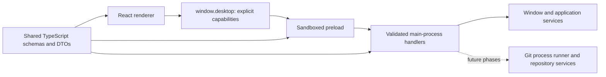

# Architecture and implementation decisions

Status: foundation, the local F01 repository slice, and the first F02 manager scan slice implemented.
Remaining Git services and manager workflows described below are design decisions, not existing code.

## Process boundaries

The renderer owns presentation and transient view state. The preload adapts a narrow API to Electron
IPC. Main owns privileges, resource lifetime, and future Git orchestration. Shared code contains
serializable data and schemas; it cannot import Electron, Node, or frontend state libraries.
DTOs cross IPC, not class instances with methods, Redux actions, errors, or native event objects.

The initial UI uses React state. The starter's Redux store contained only a context-menu demo.
Choose shared repository state management when tabs, asynchronous queries, and invalidation exist in
P02; avoid inventing a domain store in advance. Backend repository state remains authoritative.

## Build and dependency decisions

One `electron.vite.config.ts` builds main, preload, and renderer. It replaces the three Webpack
configurations and custom Electron launcher. See the [electron-vite guide](https://electron-vite.org/guide/).

Main and preload are explicit CommonJS `.cjs` bundles; the renderer uses browser ESM. The package uses
ESM for tooling. Preload dependencies are fully bundled so the sandbox only needs Electron's supported
runtime APIs. This follows [electron-vite's dependency guidance](https://electron-vite.org/guide/dependency-handling).
Do not introduce a dynamic preload chunk or a runtime require of an application dependency.

Compatibility was checked against npm metadata on 2026-09-16: electron-vite 5 accepts Vite 7, so this
project uses Vite 7 rather than upgrading independently to Vite 8. The React plugin is on its compatible
5.x line. TypeScript is on 6.0 because the selected typescript-eslint version declares support below
6.1. Electron is on 44.x, React on 19.x, and the supported development runtime is Node 24 LTS.
The exact reproducible versions live in `package-lock.json`; recheck peers before future upgrades.

Three type checks protect distinct environments: shared code has no Node/browser globals; renderer
code has browser types; backend/tooling has Node and Electron types. ESLint additionally blocks Node,
Electron, and backend imports from the shared and renderer directories.

## IPC contract

| Concern                   | Location                                      | Rule                                                               |
| ------------------------- | --------------------------------------------- | ------------------------------------------------------------------ |
| Request names and schemas | `src/common/ipc/contracts.ts`                 | Stable names such as `app:get-info`; separate input/output schemas |
| Result envelope           | `src/common/ipc/result.ts`                    | `{ ok, value }` or `{ ok, error: { code, message } }`              |
| Renderer capabilities     | `src/common/ipc/api.ts`                       | Named methods; no arbitrary channel or process access              |
| Preload implementation    | `src/backend/preload/create-desktop-api.ts`   | Validate responses/events, strip native events, bound wait time    |
| Main execution boundary   | `src/backend/electron/ipc/execute-request.ts` | Authorize first, validate input, run service, validate output      |
| Registration and routing  | `src/backend/electron/ipc/register.ts`        | Register once; route to the exact owning window                    |

The actual API is `desktop.app.getInfo()`, `desktop.window.getState()`,
`desktop.window.command({ action })`, and `desktop.window.onStateChanged(listener)`. The F01 slice adds
named `desktop.repository` methods for Git diagnostics, directory selection, open/init, recent/open
session queries, close, and recent-entry removal. The first F02 slice adds manager listing, source-root
add/remove, and explicit rescan methods. The window commands are minimize, toggle-maximize, and close.
Native titlebar/menu controls remain available.

Requests return typed result envelopes because errors crossing Electron/contextBridge lose useful
structure. Expected failures have stable codes; backend exceptions become a generic internal error.
The UI may call `unwrapResult` locally. The backend currently logs internal exceptions for development;
introduce structured, redacted logging before adding repository paths, credentials, and subprocess output.

The preload's 15-second deadline bounds short control requests. **A timeout does not cancel backend
work and must never trigger automatic retries of mutations.** Git work in P01 gets job IDs, progress
events, explicit cancellation, and queryable completion state. Do not hold a clone/rebase inside this
short request deadline or assume that an IPC disconnection rolls back Git.

Subscriptions retain the exact registered callback and return idempotent cleanup functions. The shell
subscribes in an effect and handles React Strict Mode and reloads. An initial state reply cannot overwrite
a newer event. Future repository snapshots need explicit generation IDs to reject stale responses.

Each registered window is paired with its expected document URL. Requests must originate from that
window's current top frame and exact URL (a fragment is permitted). Another frame, a navigated document,
or an unregistered window is rejected. Closing a window releases its registration and event listeners.
The registry supports multiple windows; the current shell creates one and restores it on a second launch.

To add a capability:

1. Add a serializable schema and a named request/event contract in the shared layer.
2. Add the domain method to `DesktopApi` and implement its fixed preload call.
3. Register a main handler and delegate substantive work to a service.
4. Add validation, failure, sender, and lifecycle tests where the behavior changes.
5. Connect the UI with cleanup, loading/error handling, and explicit mutation intent.

## Desktop security and lifecycle

Windows enable context isolation and sandboxing, disable Node integration and webviews, deny new windows
and permissions, and block navigation away from the application document. No generic `ipcRenderer`,
`shell`, filesystem, or command execution API is exposed. These boundaries follow
[Electron's security guidance](https://www.electronjs.org/docs/latest/tutorial/security) and
[context-isolation guidance](https://www.electronjs.org/docs/latest/tutorial/context-isolation).

Production HTML uses a CSP without inline scripts, inline styles, or remote connections. Development
permits Vite's local WebSocket and inline refresh/style bootstrap. Remote content is never loaded into
the privileged application window. Repository text and metadata must remain text, including SVG/HTML
files and commit messages. New image or syntax-rendering features require a review of their rendering path.

The current local bundle is loaded through `file:` with exact document authorization. Before handling
arbitrary repository content, P02 must evaluate a restricted custom asset protocol to reduce file-origin
exposure; repository files must never become navigable privileged documents.

The main process owns the single-instance lock, startup failures, native menus, window restoration, and
macOS activation behavior. Closing the last window quits on Linux/Windows and leaves macOS activation
available. Startup failure exits with an error rather than leaving a hidden broken window.

## Git service direction (P01 onward)

Use the installed Git CLI behind a typed service interface. This avoids committing to native bindings
before functional coverage is understood and can support existing credential helpers and Git extensions.
The UI sends domain operations and repository IDs, not shell strings or unrestricted argument lists.
Probe capabilities and explain a missing/unsupported Git installation; do not download or replace Git silently.

Use asynchronous process APIs with explicit executable, working directory, argument arrays, bounded output,
abort support, and sanitized logs. Parse machine-readable/NUL-delimited formats. For example,
[Git status porcelain v2](https://git-scm.com/docs/git-status) distinguishes index and worktree changes.
Treat paths as data, preserving unusual characters; handle platform decoding explicitly.

Resolve repository topology with [rev-parse](https://git-scm.com/docs/git-rev-parse), including separate
Git/common directories and [linked worktrees](https://git-scm.com/docs/git-worktree). Do not assume
`.git` is a directory. Coordinate writes sharing a common repository and writes to a worktree's index;
keep unrelated repositories responsive. Detect external changes, locks, and interrupted sequencers.

Normal Git hooks, filters, diff drivers, credential helpers, and configured programs can execute code.
Repository trust and explicit-operation policies belong in P01/P02, before automatic background work.
Never silently weaken Git's safe-directory checks or delete a lock simply because an operation failed.

The implemented F01 service uses this direction for read-only topology discovery and explicit local
initialization. It canonicalizes the selected path in the main process, keeps worktree/Git/common
directories as separate DTO fields, derives a stable repository identity, and scopes in-memory sessions
to the owning window. Recent entries use a versioned JSON file with atomic replacement and quarantine
of invalid data. The first F02 manager slice uses a separate versioned source-root store and a bounded
filesystem-marker scanner; it does not execute Git, follow directory symlinks, or descend into a found
repository. Remote clone, operation jobs, watcher invalidation, and the trust policy for commands that
can run repository programs are still future work.

## Current limitations

Git discovery, local repository access, recent-repository persistence, and the first source-directory
manager slice are implemented. There is still no general job queue, operation activity surface, remote
authentication, clone workflow, filesystem watcher, persisted tabs/preferences, custom manager folders,
external integration, automatic updater, or final branding. The sidebar's references and history/changes
panes remain scaffolding. Tests establish the local topology and manager behavior against disposable
repositories and the Electron bridge; later Git correctness will continue to be checked against
independent CLI assertions as each workflow is added.
